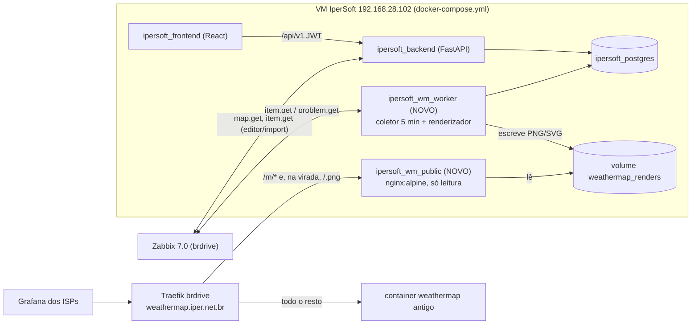

# Weathermap v2: plano de implementação

> **Para o agente de IA que vai implementar:** este documento é a especificação completa e foi feito para ser seguido sem o histórico da conversa. Leia também o [`AGENTS.md`](../../AGENTS.md) da raiz (arquitetura do IperSoft e topologia dos 3 ambientes). Cada fase tem critérios de aceite, e a regra é não avançar de fase sem cumpri-los.
>
> Autor do planejamento: Everton, com apoio do Antigravity, em 2026-11-06. Status: **aprovado para implementação**.

---

## 0. Resumo executivo

Recriar o weathermap (mapa de enlaces com volume de tráfego e cor por % de uso) como **módulo nativo do IperSoft**, aposentando o PHP Network Weathermap 0.98a que roda na VPS BrDrive.

- **Desenho dos mapas:** editor drag-and-drop no IperSoft, com nós vindos do inventário (`Asset`) e interfaces escolhidas a partir do Zabbix. Há também um importador dos mapas atuais.
- **Coleta:** a cada **5 min**, uma chamada em lote `item.get` no Zabbix.
- **Saída:** um único renderizador **SVG** no backend. O PNG é gerado a partir dele para o **Grafana dos ISPs**, que hoje usam a URL de um PNG num painel. O mesmo SVG aparece interativo no IperSoft.
- **Publicação:** domínio mantido, `https://weathermap.iper.net.br`. Imagens novas em `/m/<token>.png`. Na virada, as URLs antigas (`/atm.png`) passam a servir a imagem nova sem mexer nos painéis do Grafana.
- **Convivência:** sobe em **containers novos, ao lado do weathermap antigo, que não é tocado** até a virada.
- **Visual:** **linha única por enlace**, colorida pelo sentido mais carregado.

---

## 1. Contexto do sistema atual (o que vamos substituir)

Local: `ssh brdrive` → `/opt/weathermap`. Também é um repo git local, com commits `v1`, `v2`, `dual link`, `Containerizar...`.

| Item | Detalhe |
|---|---|
| Motor | PHP Network Weathermap 0.98a + `lib/datasources/WeatherMapDataSource_zabbix.php` |
| Scripts do Everton | `web/export_zabbix_maps.py` (`map.get` com `selectSelements`/`selectLinks` → JSON em `web/tmp/maps/`), `web/get_trigger_data.py` (triggers dos links → itemids em `web/triggers/`), `web/generate_conf.py` (JSON → `configs/<mapa>.conf`). Há cópias antigas em `weathermap-scripts/`, que devem ser ignoradas |
| Execução | `/etc/crontab` **do host** (root): `*/5 * * * * root cd /opt/weathermap && php <mapa>` para athila, atm, bkup, diretrix, infonet, inforline, lhtech, oestenet, rtnet. Os mapas `iper`, `seven`, `teste` têm `.conf` mas não estão no cron |
| Saída | `/opt/weathermap/<mapa>.png` e `<mapa>.html`, servidos pelo container `weathermap` (php:7.4-apache) via Traefik (labels docker, router `weathermap`, entrypoint `websecure`, certresolver `le`, rede `infra`) |
| Consumo | O Grafana dos ISPs tem painéis com a URL `https://weathermap.iper.net.br/<mapa>.png` |

### 1.1 Formato dos `.conf` (relevante para o importador)
```
WIDTH 1500
HEIGHT 1000
TITLE atm
SCALE DEFAULT <min%> <max%> <R> <G> <B>
SET zabbix_auth_token <...>          # SEGREDO, não importar
NODE <nome>
	LABEL <texto>
	LABELOFFSET N|S|E|W
	ICON images/<arquivo>.png
	POSITION <x> <y>
LINK <nome>
	TARGET zabbix:itemid:<host>:<itemid_IN>:<itemid_OUT>
	NODES <nodeA>[:<offset>] <nodeB>[:<offset>]
	BANDWIDTH <n>M|G
	VIA <x> <y>                      # 0..N vezes
	WIDTH <px>
```
- `TARGET`: o **primeiro itemid é IN**, o **segundo é OUT**, do ponto de vista do host (nó A). Os valores do Zabbix já estão em **bits/s**.
- O `LINK DEFAULT` define padrões (ex.: `BANDWIDTH 10000M`, `WIDTH 4`), aplicados a links sem valor próprio.
- No Zabbix, a banda vem da 1ª linha do label do link (`1g`, `10g`, `40g`, `100g`, `10m`, `100m`) e o offset da 2ª (`n40`, `s40`, `e80`, `w80`).

### 1.2 Escala de cores atual (manter os limiares como padrão)
| % uso | Cor RGB |
|---|---|
| 0 (exato) | 192,192,192 |
| 0–1 | 255,255,255 |
| 1–10 | 140,0,255 |
| 10–25 | 32,32,255 |
| 25–40 | 0,192,255 |
| 40–55 | 0,240,0 |
| 55–70 | 240,240,0 |
| 70–85 | 255,192,0 |
| 85–100 | 255,0,0 |

Na v2 a escala é JSON por mapa, com esse padrão. Pode-se suavizar os tons para ficar mais moderno, mantendo os limiares.

---

## 2. Fase 0: segurança da VPS atual (fazer primeiro, **com aprovação do Everton**)

Achados confirmados em 2026-11-06: `https://weathermap.iper.net.br` é público e sem autenticação. Respondem HTTP 200: `editor.php` (com `$ENABLED=true`), `web/api/save_file.php` (sobrescreve `.conf` sem login, e esses arquivos são processados como root pelo cron do host) e `web/zabbix_config.php`. Os tokens da API do Zabbix estão em texto puro em `configs/*.conf`, `web/api/zabbix_config.json` e `weathermap-scripts/zabbix_config.json`.

Ações, **sem reiniciar o container**. O Apache tem `AllowOverride All` e o diretório está montado como volume, então um `.htaccess` vale na hora:

1. `/opt/weathermap/.htaccess`:
   ```apache
   <FilesMatch "^(editor|cacti-pick|check|check-gdbug|setup|weathermap-cacti-.*)\.php$">
       Require all denied
   </FilesMatch>
   ```
2. `/opt/weathermap/web/.htaccess`: Basic Auth para todo o `web/` (dashboard, editor de arquivos, API). Gerar `/opt/weathermap/configs/.htpasswd`, que já é bloqueado por `<Directory configs> Require all denied` no Apache, com `htpasswd` dentro do container:
   ```apache
   AuthType Basic
   AuthName "Weathermap Admin"
   AuthUserFile /var/www/html/configs/.htpasswd
   Require valid-user
   ```
   Não use `Require ip`, porque atrás do Traefik o IP visto é o do proxy.
3. Validar: `/atm.png` e `/atm.html` continuam **200** (o Grafana depende disso). `editor.php` passa a dar **403** e `web/api/save_file.php` passa a dar **401**.
4. Rotacionar o token da API do usuário Zabbix `weathermap`. Atualizar `web/api/zabbix_config.json` e rodar `generate_conf.py`, ou fazer `sed` do `SET zabbix_auth_token` nos `.conf`. Confirmar no próximo ciclo de 5 min que os PNGs continuam atualizando (ver o mtime).
5. **Não** apagar nada. Isso fica para a Fase 7.

**Aceite:** os PNG/HTML continuam públicos, as ferramentas de escrita ficam bloqueadas e os PNGs continuam sendo regenerados com o token novo.

---

## 3. Arquitetura alvo



### 3.1 Por que dois containers novos
| Container | Imagem | Portas | Responsabilidade |
|---|---|---|---|
| `ipersoft_wm_worker` | mesma imagem do `backend` (build `./backend`), `command: python -m app.weathermap.worker` | nenhuma | Loop de 5 min: lê mapas no Postgres, consulta o Zabbix, grava amostras, renderiza SVG+PNG no volume |
| `ipersoft_wm_public` | `nginx:alpine` | `8090:80` | Serve **só arquivos estáticos** do volume (read-only). Sem banco, sem API, sem segredo |

O único processo exposto na internet é um nginx servindo PNG. Uma falha nele não dá acesso ao IperSoft nem ao Zabbix. O backend existente (porta 8000) **continua não exposto**.

---

## 4. Modelo de dados (backend)

Arquivo novo: `backend/app/models/weathermap.py`. Importar em `backend/app/models/__init__.py` para o `Base.metadata.create_all` (chamado em `main.py`) criar as tabelas. O projeto **não usa Alembic**: colunas adicionadas depois de criada a tabela vão como `ALTER TABLE ... ADD COLUMN IF NOT EXISTS` no bloco de migrações idempotentes de `main.py`.

```python
class WeathermapMap(Base):
    __tablename__ = "weathermap_maps"
    id            = Column(Integer, primary_key=True)
    name          = Column(String(150), nullable=False)            # título exibido
    client_group  = Column(String(100), index=True, nullable=True) # mesmo conceito de Asset.client_group
    width         = Column(Integer, default=1500, nullable=False)
    height        = Column(Integer, default=1000, nullable=False)
    theme         = Column(String(20), default="light")            # 'light' | 'dark' (PNG do Grafana)
    background    = Column(String(255), nullable=True)             # cor hex ou caminho de imagem
    scale         = Column(JSON, nullable=False)                   # [{"min":0,"max":1,"color":"#ffffff"}, ...]
    public_token  = Column(String(64), unique=True, index=True, nullable=False)  # secrets.token_urlsafe(24)
    legacy_name   = Column(String(64), unique=True, nullable=True) # ex 'atm' -> serve /atm.png na virada
    legacy_enabled= Column(Boolean, default=False, nullable=False) # só publica /<legacy>.png quando True
    source        = Column(String(50), default="manual")           # 'manual' | 'legacy_conf' | 'zabbix:<sysmapid>'
    is_active     = Column(Boolean, default=True, nullable=False)
    last_render_at= Column(DateTime(timezone=True), nullable=True)
    last_render_error = Column(Text, nullable=True)
    created_at / updated_at  (mesmo padrão de Asset)
    nodes = relationship("WeathermapNode", cascade="all, delete-orphan")
    links = relationship("WeathermapLink", cascade="all, delete-orphan")

class WeathermapNode(Base):
    __tablename__ = "weathermap_nodes"
    id        = Column(Integer, primary_key=True)
    map_id    = Column(ForeignKey("weathermap_maps.id", ondelete="CASCADE"), index=True, nullable=False)
    asset_id  = Column(ForeignKey("assets.id", ondelete="SET NULL"), nullable=True)  # opcional (upstream/nuvem não tem asset)
    key       = Column(String(100), nullable=False)    # identificador único no mapa (nome do NODE legado)
    label     = Column(String(150), nullable=False)
    x         = Column(Integer, nullable=False)
    y         = Column(Integer, nullable=False)
    icon      = Column(String(30), default="router")   # router|switch|olt|server|cloud|firewall|generic
    label_pos = Column(String(2), default="S")         # N|S|E|W
    zabbix_hostid = Column(String(50), nullable=True)  # para cor de alarme quando não há asset
    __table_args__ = (UniqueConstraint("map_id", "key"),)

class WeathermapLink(Base):
    __tablename__ = "weathermap_links"
    id           = Column(Integer, primary_key=True)
    map_id       = Column(ForeignKey("weathermap_maps.id", ondelete="CASCADE"), index=True, nullable=False)
    node_a_id    = Column(ForeignKey("weathermap_nodes.id", ondelete="CASCADE"), nullable=False)
    node_b_id    = Column(ForeignKey("weathermap_nodes.id", ondelete="CASCADE"), nullable=False)
    label        = Column(String(150), nullable=True)   # ex 'BGP Unifique'
    zabbix_host  = Column(String(150), nullable=True)   # host técnico do item (informativo)
    itemid_in    = Column(String(50), nullable=True)    # bits/s recebidos pelo nó A
    itemid_out   = Column(String(50), nullable=True)    # bits/s enviados pelo nó A (A->B)
    itemid_status= Column(String(50), nullable=True)    # opcional: net.if.status / ifOperStatus (1=up,2=down)
    capacity_bps = Column(BigInteger, nullable=False, default=1_000_000_000)
    via_points   = Column(JSON, default=list)            # [[x,y], ...]
    offset_a     = Column(String(10), nullable=True)     # ex 'N40' (compat. legado)
    offset_b     = Column(String(10), nullable=True)
    width        = Column(Integer, nullable=True)        # override de espessura (px)

class WeathermapSample(Base):
    __tablename__ = "weathermap_samples"
    id         = Column(BigInteger, primary_key=True)
    link_id    = Column(ForeignKey("weathermap_links.id", ondelete="CASCADE"), index=True, nullable=False)
    ts         = Column(DateTime(timezone=True), index=True, nullable=False)  # horário da coleta
    in_bps     = Column(Float, nullable=True)
    out_bps    = Column(Float, nullable=True)
    status     = Column(String(10), nullable=False)    # ok | no_data | stale | down
    __table_args__ = (Index("ix_wm_sample_link_ts", "link_id", "ts"),)
```
Retenção de `weathermap_samples`: **30 dias** (purga diária no worker).

---

## 5. Backend: estrutura de código

Convenções do projeto: FastAPI com SQLAlchemy síncrono (`SessionLocal`, `get_db` em `app/database.py`), routers com prefixo `/api/v1` registrados em `main.py`, autenticação por `get_current_user` (`app/routers/auth.py`) e papel `admin` em `user.role`. Credenciais do Zabbix em `IntegrationConfig` com `name == "zabbix"` (campos `url`, `public_url`, `token`, `username`, `password`). Cliente: `ZabbixService.call_api(url, method, params, auth=token)` em `app/services/zabbix.py`.

```
backend/app/
├── models/weathermap.py
├── schemas/weathermap.py          # Pydantic: MapOut, MapFull (com nodes+links), MapSave, LinkState...
├── routers/weathermap.py          # API autenticada (seção 5.4)
└── weathermap/                    # pacote do módulo
    ├── __init__.py
    ├── scale.py                   # escala padrão, color_for(pct, scale), fmt_bps()
    ├── collector.py               # coleta Zabbix -> estado por link (seção 5.1)
    ├── renderer.py                # render_svg(map, nodes, links, state, alarms, *, interactive) -> str
    ├── raster.py                  # svg_to_png(svg:str) -> bytes
    ├── publisher.py               # grava arquivos no volume de forma atômica (seção 5.3)
    ├── worker.py                  # entrypoint do container worker (loop 5 min)
    ├── import_legacy.py           # CLI: importa configs/*.conf do PHP Weathermap
    └── import_zabbix.py           # importa sysmap do Zabbix (map.get)
```

Dependências novas (`backend/requirements.txt`): `resvg-py` para SVG→PNG (sem dependências nativas). **Fallback** se o wheel não instalar: `cairosvg`, com `libcairo2` no `Dockerfile`. Instalar fonte no Dockerfile: `fonts-dejavu-core`. Usar `font-family="DejaVu Sans"` no SVG para o PNG ficar igual no servidor e no navegador.

### 5.1 Coletor (`collector.py`)
1. Carrega todos os links de mapas `is_active`, juntando os itemids não nulos (`in`, `out`, `status`).
2. Faz **uma** chamada `item.get` (em lotes de 500 itemids):
   `{"itemids": [...], "output": ["itemid","hostid","key_","lastvalue","lastclock","units","state","status","delay"]}`.
3. Normaliza o valor:
   - `units` em `bps`/`b/s`: usa direto.
   - `units` em `Bps`/`B` (bytes): multiplica por 8.
   - `state == "1"` (unsupported) ou `lastclock == 0`: trata como `None`.
4. Status do link:
   - `down`: `itemid_status` existe e `lastvalue == 2`.
   - `no_data`: in e out ambos `None`.
   - `stale`: `now - lastclock > 15 min`.
   - Caso contrário, `ok`.
5. Uso: `pct_in = in/capacity*100`, `pct_out = out/capacity*100`, `pct = max(pct_in, pct_out)`, limitado a 100 para a cor (o rótulo mostra o real).
6. Alarmes dos nós: `problem.get` com `hostids` (de `node.zabbix_hostid` ou `asset.zabbix.hostid`), `recent=false`, `suppressed=false`, `output: ["eventid","objectid","severity"]` + `selectHosts`, ou via `trigger.get` como em `fetch_host_problems`. Guarda a maior severidade por host.
7. Retorna `{link_id: LinkState(in_bps, out_bps, pct, status, ts)}` e `{node_id: max_severity}`.

Tratamento de erro: se o Zabbix falhar, **não** sobrescrever os PNGs com um mapa vazio. Mantém o último PNG e grava `last_render_error`. Se a falha passar de 30 min, renderiza com um selo "dados indisponíveis desde HH:MM".

### 5.2 Renderizador (`renderer.py`): especificação visual
Função pura, sem I/O. **Todo texto passa por escape XML** (`xml.sax.saxutils.escape`/`quoteattr`), porque o SVG é injetado no DOM do frontend.

- **Canvas:** `width`×`height` do mapa, fundo pelo tema (light `#ffffff`, dark `#0f172a`, ou `background`).
- **Cabeçalho:** título (canto superior esquerdo), `Atualizado: dd/mm/aaaa HH:MM` (fuso `America/Sao_Paulo`) e a legenda da escala como barra com faixas e rótulos de %.
- **Enlace (linha única):**
  - Caminho de A até B passando por `via_points`, com curvas suaves (Catmull-Rom → Bézier cúbica). Sem via points, uma reta. Pontas deslocadas por `offset_a/offset_b` (N/S/E/W + px, compatível com o legado).
  - Espessura pela capacidade, se `width` não estiver definido: ≤100M = 3px, ≤1G = 5px, ≤10G = 8px, ≤40G = 10px, acima disso 12px.
  - Cor: `color_for(pct, scale)`.
  - Estados: `no_data` em cinza `#9ca3af` tracejado (`stroke-dasharray 6 4`), `stale` com cor normal e `opacity .45`, `down` em vermelho `#dc2626` tracejado com o rótulo "DOWN".
  - Contorno sutil (stroke 1px a mais, mais escuro e baixa opacidade) para dar contraste no fundo claro.
  - **Seta de sentido dominante** pequena no meio do caminho, apontando para B se `out ≥ in` e para A caso contrário.
  - **Rótulo em pílula** no ponto médio, com fundo semi-opaco e borda da cor do enlace: `↑ 830M  ↓ 120M · 42%`. `↑` = OUT do nó A (A→B), `↓` = IN do nó A. Formato por `fmt_bps` (`K`/`M`/`G`, 1 casa decimal, sem casa decimal quando ≥100).
- **Nó:**
  - Círculo de 18px de raio com ícone simples por `icon`. Desenhar paths SVG embutidos, sem depender de PNGs.
  - **Anel externo** com a cor da maior severidade ativa: 5 Disaster `#e45959`, 4 High `#e97659`, 3 Average `#ffa059`, 2 Warning `#ffc859`, 1 Info `#7499ff`, 0 sem anel.
  - Label conforme `label_pos`, em pílula clara.
- **Ordem de desenho:** enlaces, depois rótulos dos enlaces, depois nós, depois labels dos nós.
- **Modo `interactive=True`** (para o IperSoft):
  - Cada grupo recebe `id="link-<id>"` / `id="node-<id>"` e `data-*` (`data-in`, `data-out`, `data-pct`, `data-asset-id`, `data-status`).
  - Adiciona a classe CSS `wm-flow` nos enlaces `ok` (o frontend anima o tracejado).
  - Sem `<script>` dentro do SVG.

### 5.3 Publicação (`publisher.py`) e worker (`worker.py`)
Volume montado em `/renders` no worker:
```
/renders/m/<public_token>.png
/renders/m/<public_token>.svg
/renders/legacy/<legacy_name>.png      # só se legacy_enabled
/renders/_health.json                  # {"last_cycle": iso, "maps_ok": n, "maps_error": n}
```
- Escrita **atômica**: grava em `<arquivo>.tmp` e faz `os.replace`.
- Ao trocar `public_token` ou `legacy_name`, ou desativar o mapa, apagar os arquivos antigos. O worker reconcilia a cada ciclo e remove do volume o que não corresponde a mapa ativo.
- Loop do worker:
  - Alinha ao múltiplo de 5 min + 30 s (ex.: 12:05:30) para pegar valores frescos do Zabbix.
  - Faz coleta → grava `WeathermapSample` (um por link) → renderiza todos os mapas ativos → publica → atualiza `last_render_at`.
  - Uma vez ao dia, purga amostras com mais de 30 dias.
  - Um erro em um mapa não interrompe os outros.
  - Logs via `logging` (padrão do projeto).
- Variável `WM_INTERVAL_SECONDS` (padrão 300) para permitir reduzir o intervalo no futuro.

### 5.4 API autenticada (`routers/weathermap.py`, prefixo `/api/v1/weathermap`)
Leitura para qualquer usuário logado. Escrita (POST/PUT/DELETE) só para `admin`.

| Método | Rota | Descrição |
|---|---|---|
| GET | `/maps` | Lista mapas (id, nome, client_group, nº de nós/links, last_render_at, erro, URLs públicas) |
| POST | `/maps` | Cria mapa vazio (gera `public_token`, escala padrão) |
| GET | `/maps/{id}` | Mapa completo (nodes + links) para o editor |
| PUT | `/maps/{id}` | **Salva o mapa inteiro** (metadados + lista de nodes + lista de links) numa transação. Nodes/links sem `id` são criados, os ausentes no payload são removidos. Validar que os links referenciam nodes do mesmo mapa |
| DELETE | `/maps/{id}` | Remove o mapa |
| POST | `/maps/{id}/rotate-token` | Gera novo `public_token` |
| GET | `/maps/{id}/render.svg` | SVG `interactive=True` com o **último estado** (última amostra por link + alarmes atuais). Não chama o Zabbix nessa rota, usa o banco |
| GET | `/maps/{id}/state` | JSON `{links:{id:{in,out,pct,status,ts}}, nodes:{id:{severity}}}` |
| GET | `/links/{id}/history?hours=24` | Série de `weathermap_samples` (para o tooltip). Se houver menos de 24h de amostras, completar com `history.get` do Zabbix (`history=3`, itemids in/out) |
| GET | `/zabbix/hosts?search=` | `host.get` (hostid, host, name) para o editor. Priorizar os hosts já vinculados a Assets |
| GET | `/zabbix/hosts/{hostid}/interfaces` | `item.get` do host com `search: {key_: "net.if"}` + `searchWildcardsEnabled`, e também SNMP (`ifHCInOctets`, "Bits received"/"Bits sent"). **Agrupar por interface** (conteúdo entre colchetes da key ou nome) → `[{ifname, itemid_in, itemid_out, itemid_status?, speed_bps?}]`. `speed_bps` vem de `net.if.speed[...]`/`ifHighSpeed` quando existir |
| POST | `/import/legacy` | (admin) upload de um ou mais `.conf` → cria mapas (usa `import_legacy.py`) |
| POST | `/import/zabbix/{sysmapid}` | (admin) importa um sysmap |
| GET | `/zabbix/maps` | Lista sysmaps (`map.get` output `sysmapid,name`) para o importador |

Registrar o router em `main.py` como os demais (`app.include_router(weathermap_router, prefix="/api/v1")`).

### 5.5 Importadores
**`import_legacy.py`** é o caminho principal da migração, porque reproduz exatamente o que os ISPs veem hoje.
- Parser de blocos `NODE`/`LINK` (seção 1.1). Ignorar `NODE DEFAULT`/`LINK DEFAULT`, mas aplicar seus valores como padrão. **Ignorar todas as linhas `SET`** (contêm segredos).
- `legacy_name` = nome do arquivo sem `.conf`. `name` = `TITLE`. `width/height` vêm do arquivo. `source = 'legacy_conf'`.
- `NODE`: `key` = nome, `label` = LABEL, `x,y` = POSITION, `label_pos` = LABELOFFSET.
  - `icon`: inferir pelo nome do arquivo do ICON (`cloud` → cloud, `switch` → switch, `olt` → olt, senão router).
  - Vincular `asset_id` por comparação case-insensitive de `key` com `Asset.hostname`, `Asset.name` ou `AssetZabbix.host`.
- `LINK`: `NODES a[:off] b[:off]`, `TARGET zabbix:itemid:<host>:<in>:<out>`, `BANDWIDTH` (M/G → bps), `VIA` (lista), `WIDTH`. Item `0` = sem item (`None`).
- Idempotente: reimportar o mesmo `legacy_name` **substitui** nodes/links, mas preserva `public_token`.
- CLI: `python -m app.weathermap.import_legacy /caminho/configs/*.conf`.
- Obter os arquivos: `scp brdrive:/opt/weathermap/configs/*.conf /tmp/wm_legacy/`. **Nunca copiar para dentro do repositório** (contêm tokens). Apagar depois.

**`import_zabbix.py`** (para mapas novos desenhados no Zabbix):
- `map.get` com `sysmapids`, `selectSelements: "extend"`, `selectLinks: "extend"`.
- Selements com `elementtype 0` (host): `elements[0].hostid`, viram nó vinculado ao Asset por `AssetZabbix.hostid`. `elementtype 4` (imagem): nó `cloud`. Posição = `x,y`, label = `label` (expandir `{HOST.NAME}` para o nome do host).
- Links: `selementid1/2` → nós. Capacidade e offset pela convenção de label (seção 1.1).
- Itens: `linktriggers` → `trigger.get` com `selectFunctions` → itemids → `item.get` (key_, name). **Classificar IN/OUT pela key ou nome** (`net.if.in`, `ifHCInOctets`, "Bits received" = IN; `net.if.out`, `ifHCOutOctets`, "Bits sent" = OUT). Não depender da ordem dos triggers, que era um ponto frágil do script antigo.
- `source = 'zabbix:<sysmapid>'`. Reimportação idempotente, como no legado.

---

## 6. Frontend

Stack: React 19 + Vite, `lucide-react`, CSS próprio em `App.css` (design system com temas claro e escuro via `context/ThemeContext.jsx`), chamadas via `services/api.js`. Navegação por estado `activeNav` em `App.jsx` + botões em `components/Navbar.jsx`. Não há react-router.

Dependência nova: `@xyflow/react` (React Flow v12) para o editor.

| Arquivo | Conteúdo |
|---|---|
| `Navbar.jsx` / `App.jsx` | Novo item `activeNav === 'weathermap'` com ícone `Network` ou `Map` (lucide) e label "Weathermap" |
| `components/weathermap/WeathermapList.jsx` | Cards dos mapas: nome, cliente, thumbnail (`render.svg`), "atualizado há X min", erro, botões Abrir / Editar (admin) / Copiar URL pública / Rotacionar token (admin). Botões de importar (`.conf` ou sysmap Zabbix) para admin |
| `components/weathermap/WeathermapViewer.jsx` | Busca `GET /maps/{id}/render.svg` (com o header JWT do `api.js`) e injeta num container com zoom/pan (CSS transform + wheel). Recarrega a cada 60 s (o dado muda a cada 5 min). Hover em `[id^=link-]` mostra tooltip com in/out/% e mini gráfico 24h (`/links/{id}/history`, gráfico SVG simples, sem lib nova). Clique em nó com `data-asset-id` abre o `AssetDetailView` (`setSelectedAssetId` + `setActiveNav('assets')`, como já é feito no app). Botão tela cheia (modo NOC). CSS `@keyframes` no `.wm-flow` (stroke-dashoffset) para a animação de fluxo |
| `components/weathermap/WeathermapEditor.jsx` | React Flow com **coordenadas 1:1 com o mapa** (nó em `x,y` = posição no PNG). Snap grid de 10px. Retângulo de fundo com `width×height` mostrando a área do PNG. Custom node (ícone + label) e custom edge (linha única + pílula de preview usando `/state`). Painel lateral de propriedades. Barra: Salvar (PUT do mapa inteiro), Pré-visualizar (abre `render.svg`), Desfazer simples (pilha local) |
| `.../NodePropertiesPanel.jsx` | Label, ícone, posição do label. **Asset picker** (busca nos Assets existentes, preenche label e `zabbix_hostid`). Opção "nó livre" (upstream/nuvem) |
| `.../LinkPropertiesPanel.jsx` | Label. **Interface picker**: escolhe o host (padrão: host do nó A) e depois a interface (`/zabbix/hosts/{hostid}/interfaces`), preenchendo `itemid_in/out/status`. Capacidade com presets (100M, 1G, 10G, 40G, 100G) e sugestão por `speed_bps`. Botão "inverter sentido" (troca in/out). Adicionar/remover via points (duplo clique na aresta) |

Regras:
- Usuários não-admin só veem List + Viewer.
- O SVG vem do backend com textos escapados. Só então usar `dangerouslySetInnerHTML`, e só para esse SVG.

---

## 7. Infraestrutura

### 7.1 `docker-compose.yml` do IperSoft (acrescentar, sem alterar os serviços existentes)
```yaml
  wm_worker:
    build:
      context: ./backend
      dockerfile: Dockerfile
    container_name: ipersoft_wm_worker
    restart: unless-stopped
    command: ["python", "-m", "app.weathermap.worker"]
    environment:
      DATABASE_URL: postgresql+psycopg2://${POSTGRES_USER:-ipersoft_user}:${POSTGRES_PASSWORD:-ipersoft_secret}@db:5432/${POSTGRES_DB:-ipersoft_db}
      TZ: America/Sao_Paulo
      WM_INTERVAL_SECONDS: "300"
      WM_RENDER_DIR: /renders
    volumes:
      - ./backend:/app
      - weathermap_renders:/renders
    depends_on:
      db:
        condition: service_healthy

  wm_public:
    image: nginx:alpine
    container_name: ipersoft_wm_public
    restart: unless-stopped
    ports:
      - "8090:80"
    volumes:
      - weathermap_renders:/usr/share/nginx/renders:ro
      - ./infra/weathermap/nginx.conf:/etc/nginx/conf.d/default.conf:ro
    depends_on:
      - wm_worker

volumes:
  postgres_data:
  weathermap_renders:
```
Observação: o worker lê o token do Zabbix de `IntegrationConfig`, por isso usa a mesma `DATABASE_URL` do backend. O container público **não** tem acesso ao banco.

### 7.2 `infra/weathermap/nginx.conf` (arquivo novo no repo)
```nginx
server {
    listen 80;
    server_tokens off;
    root /usr/share/nginx/renders;
    autoindex off;

    add_header Cache-Control "public, max-age=60" always;
    add_header X-Content-Type-Options nosniff always;

    location ~ ^/m/[A-Za-z0-9_-]{16,}\.(png|svg)$ { try_files $uri =404; }
    location ~ ^/([a-z0-9_-]+)\.png$ { try_files /legacy/$1.png =404; }   # URLs antigas (só existem se legacy_enabled)
    location = /healthz { default_type application/json; try_files /_health.json =404; }
    location / { return 404; }
}
```

### 7.3 Traefik na BrDrive: arquivo novo `/opt/traefik/dynamic/weathermap-v2.yml`
O Traefik v2.11 da BrDrive já carrega `/opt/traefik/dynamic/` (existe o `oracle.yml` como exemplo de estilo). Usar o mesmo entrypoint (`websecure`) e o mesmo certresolver (`le`) das labels do container antigo.
```yaml
http:
  routers:
    weathermap-v2:
      rule: "Host(`weathermap.iper.net.br`) && PathPrefix(`/m/`)"
      entryPoints: [websecure]
      service: weathermap-v2
      priority: 1000
      tls:
        certResolver: le
    # Fase 6 (virada): descomentar e listar os mapas já validados
    # weathermap-v2-legacy:
    #   rule: "Host(`weathermap.iper.net.br`) && Path(`/atm.png`, `/rtnet.png`)"
    #   entryPoints: [websecure]
    #   service: weathermap-v2
    #   priority: 1000
    #   tls:
    #     certResolver: le
  services:
    weathermap-v2:
      loadBalancer:
        servers:
          - url: "http://192.168.28.102:8090"
```
- Antes, verificar de dentro da BrDrive: `curl -sI http://192.168.28.102:8090/healthz`. O caminho BrDrive → VM existe (o Oxidized usa `192.168.28.102:8000`). Se a porta 8090 estiver bloqueada por firewall na VM, liberar só para a origem da BrDrive.
- **Rollback:** apagar o arquivo (o Traefik recarrega sozinho). O router do container antigo **não é alterado**.

---

## 8. Fases de implementação e critérios de aceite

| Fase | Entregas | Aceite |
|---|---|---|
| **0** | Segurança da VPS atual (seção 2), **somente após OK do Everton** | Ver seção 2 |
| **1** | Models + migrations, `scale.py`, `collector.py`, `renderer.py`, `raster.py`, `import_legacy.py` + testes unitários do parser e do renderer | Importar os 13 `.conf` sem erro. Para `atm`: 35 links e os nós com as mesmas posições. SVG válido (parse com `xml.etree`). PNG gerado com o tamanho do mapa |
| **2** | `worker.py`, `publisher.py`, serviços `wm_worker` + `wm_public` no compose, `nginx.conf` | `curl http://192.168.28.102:8090/m/<token>.png` retorna PNG atualizado a cada 5 min. `/healthz` ok. Os containers antigos e o IperSoft continuam funcionando |
| **3** | Router `weathermap-v2` no Traefik (7.3) + painel de teste no Grafana com `/m/<token>.png` | `https://weathermap.iper.net.br/m/<token>.png` = 200. `https://weathermap.iper.net.br/atm.png` **continua vindo do sistema antigo**. Comparação visual e de valores lado a lado de todos os mapas, com diferença de tráfego por link dentro de ±5% no mesmo ciclo |
| **4** | API autenticada (5.4) + List + Viewer no frontend | Usuário logado vê os mapas, tooltip com histórico, clique abre o ativo. Não-admin não consegue escrever (403) |
| **5** | Editor (React Flow) + interface picker + importador Zabbix | Criar um mapa do zero só pelo IperSoft, com nós do inventário e enlace com interface escolhida, e vê-lo no PNG público no ciclo seguinte. Importar um sysmap com IN/OUT classificados corretamente |
| **6** | Virada, mapa a mapa: `legacy_enabled=true` + incluir `/<mapa>.png` no router legacy do Traefik | O painel do ISP (URL antiga) mostra a imagem nova. Rollback testado (remover o path e voltar a ver a antiga) |
| **7** | Desativação do antigo (só depois de todos os mapas virados e de ~1 semana estável): remover as linhas `#weathermaps` do `/etc/crontab` da BrDrive, `docker compose down` em `/opt/weathermap`, arquivar `tar czf /root/weathermap-legacy-<data>.tgz /opt/weathermap`. Mover o roteamento do domínio inteiro para o v2 (router `Host(...)` sem path) | Nenhum painel quebrado. Atualizar o `AGENTS.md` (seção 8.3 e nova seção do módulo Weathermap) |

---

## 9. Regras e cuidados para o implementador

- **Não alterar** o container `weathermap`, o `/etc/crontab` nem os arquivos em `brdrive:/opt/weathermap` antes da Fase 7. Única exceção: a Fase 0, com aprovação.
- **Nunca** commitar `.conf` legados, tokens ou senhas. Acrescentar ao `.gitignore`: `*.conf.legacy`, `/tmp/wm_legacy`.
- Não expor o backend (8000) nem o Postgres na internet. Só o `wm_public` (8090) vai para o Traefik.
- O renderer é função pura e testável. Toda string do usuário é escapada.
- Seguir os padrões existentes: migrações idempotentes em `main.py`, logs em português, mensagens de erro HTTP em português, nomes de variáveis em inglês.
- Commits no padrão do repo (ex.: `feat(weathermap): ...`), um por fase, na branch `main` ou numa branch `feat/weathermap-v2` com PR (perguntar ao Everton).
- Ao concluir cada fase, atualizar o checklist abaixo neste arquivo.

## 10. Checklist de progresso
- [x] Fase 0: segurança da VPS atual
- [x] Fase 1: modelo, coletor, renderer, importador legado
- [x] Fase 2: worker + containers + nginx
- [x] Fase 3: Traefik `/m/` + validação lado a lado no Grafana
- [x] Fase 4: API + List/Viewer
- [x] Fase 5: Editor + importador Zabbix
- [ ] Fase 6: virada das URLs legadas (mapa a mapa)
- [ ] Fase 7: desativação do weathermap antigo + atualização do AGENTS.md

## 11. Backlog futuro (fora do escopo atual)
- Reduzir o intervalo de coleta (`WM_INTERVAL_SECONDS`), com SSE no viewer.
- Replay histórico ("mapa às 20h de ontem") usando `weathermap_samples`.
- p95 e pico diário por enlace no tooltip.
- Alarme de saturação (ex.: mais de 85% por 15 min) integrado à tela de alarmes.
- Erros e discards por interface.
- Export PDF para relatórios mensais aos ISPs.
